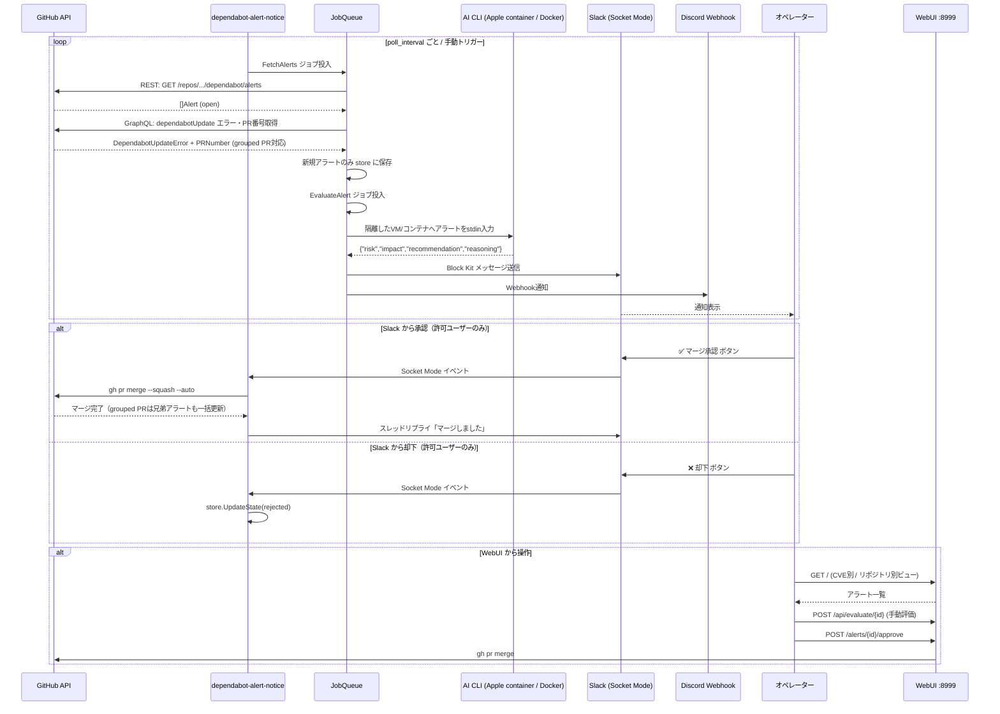
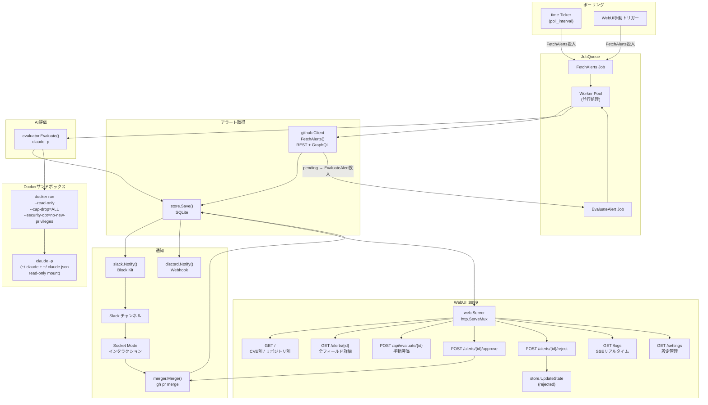
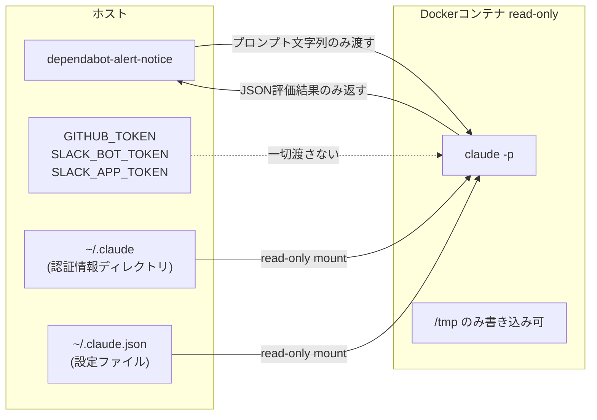
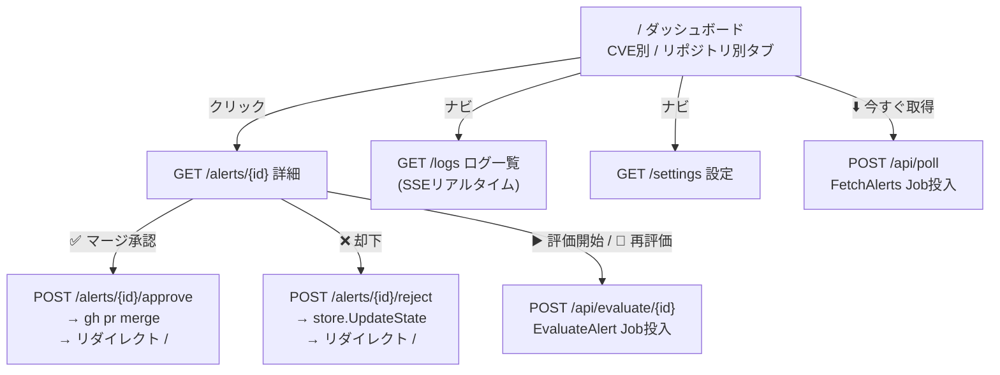
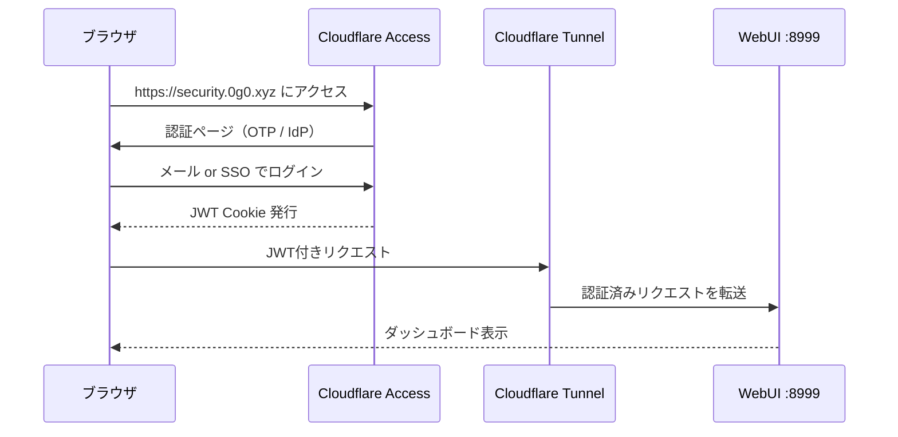

# dependabot-alert-notice

GitHub Dependabotアラートと脆弱性RSSを収集し、対応緊急度評価、Codex/ClaudeによるAI評価、Slack/Discord通知、承認後のPRマージを提供するGoアプリケーション。

普段の確認にはWeb UI/TUIを使います。Slack/Discordは既定で1時間ごとのリポジトリ別サマリーとし、件数とAI評価状況だけを知らせます。アラートの詳細やAI評価の全文は画面で確認してください。

共通セキュリティ基盤は [Phase 0](docs/security-phase0.md)、Trivy JSONのoffline取込と読み取り専用Findings APIは [Phase 1の最初の実装](docs/security-phase1.md) を参照してください。GitHub Code Scanning JSONのoffline取込は [Phase 1の次の実装](docs/security-code-scanning.md) を参照してください。Secret Scanningの秘密値を含まないoffline metadata取込は [Phase 1の第三の実装](docs/security-secret-scanning.md) を参照してください。EPSS/KEVのoffline証拠付加は [Phase 1の第四の実装](docs/security-enrichment.md) を参照してください。既存Dependabotの承認・評価・通知フローは維持します。

## Macでセットアップ・常駐運用（ビルド済み配布）

 `notification_interval: 1h` を既定とし、Slack/Discordを1時間単位でまとめます。既存設定に項目がなくてもこの既定値を使います。更新して本体を再起動すると有効になります。

この変更ではリポジトリ単位のSlack/Discord集約、AWSで危険になる利用条件のAI評価、Podman隔離を追加します。TUI、Apple containerによるAI隔離、launchd常駐管理、一式更新も利用できます。Mac mini（Apple M4 Pro・macOS 26.3）ではSSHから操作でき、Docker Desktop・ローカルブラウザ・Goの導入は不要です。`auto` はApple Silicon MacでApple container、Intel Macと他環境でDockerを選びます。Podmanは明示的に選択します。

Apple containerの実VM、M4 ProでのAI評価、ログイン前のlaunchd起動・再起動後の継続動作は開発環境で未検証です。Linuxのテスト・外部コマンドのモック検証と、ReleaseワークフローのMacネイティブ検証を区別します。実機での確認は [MAC-VERIFY.md](packaging/macos/MAC-VERIFY.md) を実施してください。アプリのDeveloper ID署名・公証は未設定です。会社の管理ポリシーで実行が拒否される場合、管理者による許可が必要です。

### 1. GitHub認証とパッケージの導入

GitHub CLIがなければ `brew install gh`、Homebrewを使わない場合は [GitHub CLI公式](https://cli.github.com/) の配布を利用してください。配布元のReleaseと、監視対象のDependabotアラートを読める権限・必要なSSO認可を準備します。

既存のCLI認証を `gh auth status` で確認します。ブラウザなしで認証する場合は、発行済みのGitHubトークンを非表示で入力します。以降のコマンドはBashで実行してください。トークンをコマンド引数や履歴に書かないでください。

```bash
read -r -s -p 'GitHub Token: ' GH_TOKEN; printf '\n'
export GH_TOKEN
gh auth status --hostname github.com

mkdir -p "$HOME/Downloads/security-notice-setup"
gh api repos/g-kari/dependabot-alert-notice/contents/scripts/setup-macos.sh \
  --jq '.content' | /usr/bin/base64 -D \
  > "$HOME/Downloads/security-notice-setup/setup-macos.sh"
bash "$HOME/Downloads/security-notice-setup/setup-macos.sh"

app_dir="$HOME/Applications/security-notice/current"
data_dir="${SECURITY_NOTICE_DATA_DIR:-$HOME/Library/Application Support/security-notice}"
mkdir -p "$data_dir"
cd "$data_dir"
"$app_dir/dependabot-alert-notice" --setup --config "$data_dir/config.yaml"
```

インストーラは最新の公開済み安定版ZIPをCPUに合わせて取得し、SHA-256とバージョンを検証して `~/Applications/security-notice/current` を切り替えます。既存の設定・DB・同じ版の配布フォルダは保持します。同時インストールはロックで拒否します。未認証時のデバイス認証はローカルブラウザを起動せず、別の端末でURLとコードを使う方式です。ブラウザを一切使わない場合は上記のトークン方式を使います。

`SECURITY_NOTICE_INSTALL_DIR` / `SECURITY_NOTICE_DATA_DIR` で保存先を変えられます。以後の導入・常駐管理・更新でも同じ値を指定してください。旧v0.2.0からは本体を停止してバックアップし、上記インストーラで一式更新します。バイナリだけの自動更新では新しいスクリプトは追加されません。

### 2. Apple containerの準備（AI評価を使う場合）

Apple Silicon・macOS 26以降では `evaluator.sandbox.runtime: auto` がApple containerを選びます。Apple container 1.5.0以降が必要です。公式の署名済みインストーラを取得して導入します。

```bash
mkdir -p "$HOME/Downloads/apple-container"
gh release download 1.5.0 --repo apple/container \
  --pattern container-1.5.0-installer-signed.pkg \
  --dir "$HOME/Downloads/apple-container"
pkgutil --check-signature "$HOME/Downloads/apple-container/container-1.5.0-installer-signed.pkg"
sudo installer -pkg "$HOME/Downloads/apple-container/container-1.5.0-installer-signed.pkg" -target /
container --version
bash "$app_dir/Build.command"
```

`Build.command` は本アプリの2つのDockerfileだけを一時ビルドコンテキストにコピーし、Apple containerでClaude/Codexイメージを作成します。ホーム、設定、認証情報はビルドへ送りません。初回はカーネル、ベースイメージ、CLIパッケージの取得が必要です。既存イメージはパッケージ更新だけでは再ビルドされないため、CLIも更新する場合は再実行してください。

AI認証はAPIキー、またはCLIのファイル認証を使います。ホストにClaude/Codex CLIをインストールしなくても、APIキー方式を利用できます。

```bash
# Claudeを使う場合
read -r -s -p 'Anthropic API Key: ' ANTHROPIC_API_KEY; printf '\n'
export ANTHROPIC_API_KEY
# Codexを使う場合（TUIでproviderをcodexへ変更）
read -r -s -p 'OpenAI API Key: ' OPENAI_API_KEY; printf '\n'
export OPENAI_API_KEY
# Slackを使う場合
read -r -s -p 'Slack Bot Token: ' SLACK_BOT_TOKEN; printf '\n'
read -r -s -p 'Slack App Token: ' SLACK_APP_TOKEN; printf '\n'
export SLACK_BOT_TOKEN SLACK_APP_TOKEN
# Discordを使う場合
read -r -s -p 'Discord Webhook URL: ' DISCORD_WEBHOOK_URL; printf '\n'
export DISCORD_WEBHOOK_URL
```

Codexのファイル認証は `${CODEX_HOME:-$HOME/.codex}/auth.json`、Claudeは `~/.claude/.credentials.json`（`claude_home` で変更可）だけを評価ごとにコピーします。macOS KeychainだけにあるClaude認証は自動で取り出しません。APIキーを使うかファイル認証を準備してください。一般ユーザー権限のCLI認証状態はサービス利用ユーザーと揃えます。

隔離の境界は次のとおりです。

- 評価ごとにLinux VMを作り、UID/GID 1000、読み取り専用ルート、全capability削除、no-new-privilegesで実行します。
- ホストからは選択した認証ファイルの専用コピーだけを読み取り専用でマウントします。ホームやリポジトリはマウントしません。ホスト側一時フォルダは0700です。
- 書き込み先はVM内の64MiB tmpfs `/tmp`。認証の作業コピーもここに置き、評価終了時にVMとホストの一時コピーを削除します。
- 既定はCPU 1、メモリ512MiB、評価60秒。VM削除には別途最大10秒を使います。削除に失敗した場合も評価結果を採用せずエラーにします。
- 通信はApple containerの `default` NATネットワークです。ホストネットワークやポート公開は使いませんが、外向き通信やホスト・LAN宛通信を許可リストで制限する機能はありません。組織の通信制限が必要なら外部ファイアウォールなどを用意してください。
- 起動・認証・隔離に失敗した評価は中止します。DockerやホストCLIへ自動で切り替えません。

AI自動評価は初期状態で無効です。準備後にTUIからプロバイダー・モデル・自動評価を設定してください。Intel Mac/LinuxでDockerを使う場合は `runtime: docker` と従来の専用イメージを使用します。

### 3. launchdで常駐登録・TUIで設定

```bash
# sudoは付けず、サービスを利用するユーザーで実行
bash "$app_dir/service-macos.sh" install
bash "$app_dir/service-macos.sh" status
"$app_dir/dependabot-alert-notice" --tui --config "$data_dir/config.yaml"

# 運用コマンド
bash "$app_dir/service-macos.sh" stop
bash "$app_dir/service-macos.sh" start
bash "$app_dir/service-macos.sh" restart
# 常駐登録自体を解除する場合（設定・DBは保持）
# bash "$app_dir/service-macos.sh" uninstall
```

system LaunchDaemonを登録し、アプリは利用ユーザーへ権限を落としてユーザーのlaunchdドメインで実行します。SSH切断に依存せず、起動時に開始し、異常終了後は再起動します。初回登録など必要な管理操作だけsudoします。FileVaultを有効にしたMacの電源投入後は、ディスクのロック解除が必要です。解除前の監視はできません。ユーザーのホームが利用可能であることも必要です。

初回登録では現在の `GH_TOKEN` / `GITHUB_TOKEN`、AIキー、Slackトークン、Discord Webhook、`CODEX_HOME`、`SECURITY_NOTICE_AUTO_UPDATE` を `service.env.sh` に保存します。既存ファイルは上書きしません。このファイルは本人所有・権限600のシェルファイルで、認証情報を含むため共有しないでください。変更する場合は `$data_dir/service.env.sh` を編集して再起動します。設定YAMLには認証情報を保存しません。

`stop` は現在のサービスを停止しますが、登録は残るため次回起動時に開始します。継続して無効にする場合は `uninstall` します。ログは `$data_dir/service.log`、状態は `status`、疎通は `curl --fail http://127.0.0.1:8999/settings` で確認できます。常駐中に `Start.command` で二重起動しないでください。手動実行だけ試す場合は `bash "$app_dir/Service.command"` を使い、Ctrl+Cで終了します。

TUIの操作と保存の仕組みは下の「設定も操作できるTUI」を参照してください。TUIから認証情報は編集せず、再起動が必要な変更は保存後に案内します。

### 4. パッケージ一式の更新

```bash
bash "$app_dir/Update.command"
"$app_dir/dependabot-alert-notice" --version
bash "$app_dir/service-macos.sh" status
```

登録済みで稼働中のサービスを停止し、最新の公開済み安定版ZIPを検証して `current` を切り替え、サービスを再開します。取得・検証に失敗した場合は旧パッケージで再開します。設定・DB・`service.env.sh`・CLI認証ファイルは保持します。手動起動中の本体は先にCtrl+Cで停止してください。未稼働のサービスや手動起動の本体は自動起動しません。再開失敗は終了コードとメッセージで報告します。

標準6時間ごとの自動更新はバイナリだけが対象です。スクリプト・ガイド・Dockerfileも更新する場合は `Update.command` を使用します。起動前チェックと定期更新を無効にするには、`service.env.sh` に `export SECURITY_NOTICE_AUTO_UPDATE=0` を設定して再起動します。間隔を指定して手動起動する場合は `bash "$app_dir/Service.command" --update-interval 1h` です。

### 5. バックアップ・復旧

```bash
bash "$app_dir/service-macos.sh" stop
umask 077
backup="$HOME/security-notice-backup-$(date +%Y%m%d-%H%M%S).tar.gz"
tar -czf "$backup" -C "$(dirname "$data_dir")" "$(basename "$data_dir")"
bash "$app_dir/service-macos.sh" start
```

停止してSQLiteの書き込みが終わってから、データフォルダ全体を保存します。バックアップには認証情報を含む `service.env.sh` が入るため、安全に保管してください。外部のCodex/Claude認証ファイルは別途保護して保存します。

復旧時はサービスを停止し、現在のデータフォルダを別名で退避してからバックアップを同じ親フォルダへ展開します。所有者がサービス利用ユーザーであること、データフォルダ0700・`service.env.sh` 0600を確認して起動します。旧バイナリへの切替だけでDB互換性を保証しません。ダウングレードが必要な場合は対応するデータのバックアップも復元します。

配布の詳細は [Mac起動ガイド](packaging/macos/MAC-START.md)、実機確認は [MAC-VERIFY.md](packaging/macos/MAC-VERIFY.md)。GUIを使う環境では `Start.command` も引き続き利用できます。

## Releaseタグに基づく自動更新

Mac/Linuxのリリース版は、常駐中も標準で6時間ごとに `g-kari/dependabot-alert-notice` の最新の公開済み安定版Releaseを確認します。現在より新しければバイナリを検証・更新し、ジョブ・Web接続・Slack処理を終了してDBを閉じてから、新しい版へ自動再起動します。PID、起動引数、環境変数、作業ディレクトリを保持します。`Start.command` は起動前にも確認します。

privateリポジトリの取得には、実行PCで認証済みのGitHub CLI (`gh`) とリポジトリの読み取り権限が必要です。未認証・通信失敗・検証失敗時は現在の版で動作を続け、次の周期で再試行します。常駐中は設定の `gh_path` を使い、`--update-gh-path` で上書きできます。初回の定期確認は指定間隔が経過してから、その後は各確認・更新処理の終了から指定間隔後に実行します。

```bash
# 確認間隔を1時間に変更
./dependabot-alert-notice --config config.yaml --update-interval 1h
bash Start.command --update-interval 1h
# 常駐中の自動更新を停止
./dependabot-alert-notice --config config.yaml --auto-update=false
# Mac起動前の確認と常駐中の自動更新を両方停止
SECURITY_NOTICE_AUTO_UPDATE=0 bash Start.command
```

Mac/Linuxでは配布バイナリから手動で確認・更新することもできます。設定ファイルやDBを開かずに実行します。

```bash
./dependabot-alert-notice --check-update
./dependabot-alert-notice --update
# 別の配布元やghパスを使う場合
./dependabot-alert-notice --update --update-repo owner/repo --update-gh-path /path/to/gh
```

`v1.2.3` 形式のSemVerタグを基準に比較します。draft、プレリリース、同じ版、旧版は適用しません。現在の版がプレビューでも、それより新しい安定版へ移行できます。`dev` やソースからの `go run`、`--once` では定期更新を起動しません。Windowsは `--check-update` で確認し、Releaseの配布物から手動更新してください。

配布側はReleaseワークフローで対象OS/CPUの `dependabot-alert-notice_<version>_<os>_<arch>.tar.gz` と `checksums.txt` を同じReleaseに用意します。安定版タグのpush後、全検証とアップロードが成功してReleaseが公開された時点で更新対象になります。draftは配信されません。チェックサムは同じReleaseから取得するSHA-256で、署名検証とは異なります。

更新はSHA-256と候補バイナリの `--version` を確認してから、同じファイルシステム上のrenameで置き換えます。確認・取得の上限は2分です。配布フォルダへの書き込み権限が必要で、同じバイナリへの並行更新はロックで拒否します。強制終了で `.update-lock` が残った場合は、更新プロセスが終了していることを確認してから削除してください。

定期更新は自動再起動により反映します。手動の `--update` はバイナリを置き換えて終了するため、常駐中のアプリには次回起動から反映されます。設定・DBは保持し、起動スクリプト、Dockerfile、`BUILD-INFO.txt` などの同梱ファイルは更新しません。それらも更新する場合はMacの `Update.command` を使用してください。DB互換性の自動ロールバックは行わないため、保存データは定期的にバックアップしてください。

## フロー



## アーキテクチャ



## セキュリティ: claude -p のDocker隔離

Dependabotアラートのパッケージ名・CVE説明文にプロンプトインジェクションが仕込まれる可能性があるため、`claude -p` を専用コンテナで実行する。



**隔離の効果:**
- ホストの `GITHUB_TOKEN` / `SLACK_*` トークンへアクセス不可
- ホストファイルシステムへの書き込み不可（`--read-only`）
- 全 Linux capability を削除（`--cap-drop=ALL`）
- 新規権限昇格禁止（`--security-opt=no-new-privileges`）
- メモリ 512MB / CPU 0.5 コア制限

## WebUI



### ダッシュボード (`/`)

**CVE別ビュー** (`/?view=cve`) — デフォルト
- CVE ID 単位でアラートをグルーピング
- Severity降順 → CVSS降順でソート

**リポジトリ別ビュー** (`/?view=repo`)
- `owner/repo` 単位でグルーピング
- 各グループ内にパッケージ・CVE・AI評価・ステータス・操作列

| 機能 | 説明 |
|---|---|
| 展開状態の保持 | `<details>` の開閉状態はsessionStorageで永続化、リロード後も復元 |
| GitHubリンク | 各アラート行に ↗ アイコンでGitHubの該当ページへ直リンク |
| 自動更新 | AI評価中のアラートがある場合、5秒間隔で自動リロード |
| 手動取得 | 「今すぐ取得」ボタンでJobQueueにFetchJobを投入 |

### 詳細ページ (`/alerts/{id}`)

GitHub Dependabot REST API + GraphQL API の全情報を表示:

| セクション | 内容 |
|---|---|
| **更新エラー** | Dependabotが更新できない場合の理由（GraphQL `dependabotUpdate.error` 由来） |
| **アラート情報** | パッケージ、リポジトリ、重要度、CVE、GHSA、CVSSスコア・ベクトル、EPSS、概要、修正バージョン、脆弱バージョン範囲、マニフェストパス、スコープ、依存関係種別、検出日・更新日・公開日 |
| **詳細説明** | `security_advisory.description`（Markdown形式の脆弱性説明） |
| **CWE** | Common Weakness Enumeration 一覧 |
| **参照リンク** | NVD、アドバイザリ等の外部リンク |
| **AI評価** | 推奨アクション、侵害内容、侵害される使い方、AWSで危険になる利用条件（構成未確認）。手動で評価開始/再評価可能 |

### ログページ (`/logs`)

- ポーリング・AI評価・マージ操作のログをSSEでリアルタイム表示

### 設定ページ (`/settings`)

- ポーリング間隔・直近活動フィルタ、監視ターゲット・除外リポジトリ、Slack/Discord設定、通知最低重要度、AI自動評価・評価最低重要度、サンドボックス設定をWebUIから変更可能

## セットアップ

### 対話型セットアップ（SSH・ヘッドレス環境）

インストール・起動が済んでいる場合は、アプリを停止し、バイナリの `--setup` で設定できます。ブラウザ・DB作成・外部通信は不要です。既存ファイルがあればその内容を初期値にし、ファイルがなければ新規作成します。

```bash
./dependabot-alert-notice --setup --config config.yaml
# 保存後、同じ作業ディレクトリで起動
./dependabot-alert-notice --config config.yaml
```

監視対象（`owner/repo` または `owner/*` をカンマ区切り）、監視間隔、CLIパス、DB保存先、Web待受IP・ポート、Slackチャンネル・承認可能ユーザー、通知重要度、AIプロバイダー・自動評価、RSS収集を順に設定します。Enterは現在値を保持し、任意項目の `-` は消去します。最後の保存確認は既定で「いいえ」です。途中で終了した場合は保存せず、入力中に設定ファイルが変更された場合も上書きを中止します。RSSの配信元やDocker隔離設定など、質問に含まれない設定は保持します。

Slackトークン・Discord Webhook URLは環境変数、または本体起動後のTUIから登録できます。`--setup` では設定済みかどうかだけを表示し、値は表示・保存しません。既存YAML内の認証情報も保存時に除去するため、環境変数またはTUIへ移してください。環境変数を使って常駐サービスとして起動する場合は、そのサービスにも渡してください。

```bash
# Bashで履歴・画面にトークンを残さず入力（Slack利用時）
read -r -s -p 'Slack Bot Token: ' SLACK_BOT_TOKEN; printf '\n'
read -r -s -p 'Slack App Token: ' SLACK_APP_TOKEN; printf '\n'
export SLACK_BOT_TOKEN SLACK_APP_TOKEN
# Discord利用時
read -r -s -p 'Discord Webhook URL: ' DISCORD_WEBHOOK_URL; printf '\n'
export DISCORD_WEBHOOK_URL
```

GitHub CLIは `gh auth status` で認証を確認します。未認証なら `gh auth login --hostname github.com --git-protocol https` を実行し、表示されたURLとコードを別の端末のブラウザで開いて認証できます。AI自動評価は利用するCLIの認証と隔離用イメージを準備してから有効にしてください。セットアップは外部サービスの接続確認を行いません。

Macの配布パッケージでは、既存の設定・DBの場所を使って次のように実行します。

```bash
app_dir="$HOME/Applications/security-notice/current"
data_dir="${SECURITY_NOTICE_DATA_DIR:-$HOME/Library/Application Support/security-notice}"
mkdir -p "$data_dir"
cd "$data_dir"
"$app_dir/dependabot-alert-notice" --setup --config "$data_dir/config.yaml"
# ブラウザを開かずに常駐起動（通常の自動更新も有効）
SECURITY_NOTICE_NO_BROWSER=1 bash "$app_dir/Start.command"
```

SSH接続やGUIセッションのない環境では、起動スクリプトはブラウザの自動起動を省略します。`RBSRequestErrorDomain Code=5` / `OSLaunchdErrorDomain Code=125` が出る旧版では、上記の `SECURITY_NOTICE_NO_BROWSER=1` を指定してください。`open Start.command` は使わず、`bash Start.command` で実行します。

保存後にアプリを再起動すると設定が反映されます。`--setup` が認識されない既存版では、この機能を含む版への更新が必要です。ソースから試す場合は `go build -o dependabot-alert-notice .` でビルドしてください。

### 設定も操作できるTUI

本体を常駐させたまま、別のターミナルから `--tui` で接続できます。TUIを終了しても本体の監視は続きます。メインメニュー・設定一覧・候補のある項目を矢印キーとEnterで選択できます。

```bash
# 本体を別のターミナル・tmux・サービスなどで起動しておく
./dependabot-alert-notice --config config.yaml
# 別のターミナルからTUIへ接続
./dependabot-alert-notice --tui --config config.yaml
# 接続先ポートを明示する場合
./dependabot-alert-notice --tui --tui-url http://127.0.0.1:8999
```

メニューから、状態・アラート一覧（最大100件）、詳細・AI評価結果、直近ログ（最大50件）、手動取得、AI評価の依頼、設定を操作できます。設定画面では次を編集できます。

- 監視対象・除外リポジトリ、監視間隔、取得条件
- Slackの通知チャンネル・承認可能ユーザー、通知重要度・承認の有効無効
- AIプロバイダー・モデル・自動評価・Apple container / Docker / Podman隔離の各設定
- RSS配信元の追加・変更・停止・削除、収集間隔・保存期間
- Web待受・DB保存先・CLIパス・ログレベル、脅威情報・サービスプロファイル・CVE評価・営業日カレンダー

`v0.3.1` 以降では `↑` / `↓`（または `j` / `k`）で移動し、Enterで選択、Escで戻ります。プロバイダー・モデル・重要度・隔離方式・有効無効・ログレベルには候補を表示します。Codexモデルには `gpt-6-luna` などがあり、モデル名の直接入力も残しています（`m` または「別モデルを直接入力」）。現在の独自モデル指定は保持します。RSS・監視対象の編集と、一覧から削除する項目の選択にも対応します。保存・削除の確認は初期選択がキャンセルです。候補から選んだだけでは保存されません。

番号入力も併用でき、端末以外からの入力や `TERM=dumb` では従来の番号操作を使います。`Ctrl+C` / `Ctrl+D` はTUIを終了して未保存の編集を破棄します。

設定項目を番号で辿り、値を入力する方法も利用できます。`a` は追加、一覧内の `d 番号` は削除、`0` は戻る、`s` は保存、`q` は編集破棄、`r` は再読込です。追加する項目はYAMLで入力し、単独の `.` で終了します。例えば監視対象は `owner: my-org` と `repo: my-repo` の2行、RSSは `name: 配信元名`、`url: https://...`、`enabled: true` の3行です。真偽値には `true` / `false` を指定し、文字列を空にするには `-` を指定します。

保存には確認があり、キャンセル・切断時には保存しません。Web UIなどが先に設定を更新していた場合は競合として拒否し、編集中の内容を表示したまま再読込を選べます。不正な設定や保存失敗でも稼働中の設定は保持します。AI隔離をTUIから無効化することはできません。

監視対象・RSS・AI評価設定は既存の更新処理へ反映します。監視間隔、通知接続、待受、保存先、GitHub CLIパス、ログレベル、脅威情報スケジュールなどは本体の再起動が必要で、保存後に案内します。TUIは本体の起動・停止・再起動を行いません。「認証・通知設定」では、Slack Bot Token・App TokenとDiscord Webhook URLを非表示で入力・保存できます。値は再表示しません。空欄は現在値を保持し、最後に確認して保存します。取消や入力途中の終了では保存しません。

認証の保存先は設定ファイル名に `.credentials.json` を付けた別ファイルです（Macの標準配置では `~/Library/Application Support/security-notice/config.yaml.credentials.json`）。本人所有・権限0600のファイルに平文で保存します。バックアップにも認証情報が含まれます。TUI保存値を環境変数・YAMLより優先し、「無効化」は環境変数が残っていても無効にします。「環境変数・YAMLに戻す」で上書きを解除できます。保存後は本体を再起動してください。画面の「本体に設定済み」は接続成功の判定ではなく、稼働中の設定値の有無です。

非表示入力はSSH・tmuxを含む端末で利用できます。パイプ入力や `TERM=dumb` での登録は拒否します。保存機能はmacOS/Linux本体に対応し、Windows本体では環境変数を使います。認証APIも更新されるため、更新後は本体も再起動してから新しいTUIを接続してください。GitHub・AIのログインは各CLIで行います。

TUIのAPI・接続先はローカル限定です。リモート環境ではSSH上でTUIを実行するか、ポート転送を使用してください。

```bash
# 別の端末から接続する場合（Mac側の8999をローカル18999へ転送）
ssh -N -L 18999:127.0.0.1:8999 user@mac-host
# 別のターミナルで実行
./dependabot-alert-notice --tui --tui-url http://127.0.0.1:18999
```

### 1. 設定ファイル作成

```bash
cp config.yaml.example config.yaml
# config.yaml を編集
```

```yaml
poll_interval: 30m
active_months: 6  # 直近6か月以内にpushがあったリポのみ対象（0=無効）
targets:
  - owner: your-org
    repo: your-repo
slack:
  channel_id: C0123456789
  allowed_user_ids: []  # 空=全員許可。承認・却下を許可するSlack User ID (U...) リスト
notify_min_severity: low  # 通知する最低重要度
```

```bash
export SLACK_BOT_TOKEN=xoxb-...
export SLACK_APP_TOKEN=xapp-...
export DISCORD_WEBHOOK_URL=https://discord.com/api/webhooks/...  # オプション
```

### 2. Dockerイメージビルド（claude -p 隔離用）

```bash
eval "$(devbox shellenv)"
just build-evaluator-image
```

### 3. 実行

```bash
# 1回だけ実行（テスト）
go run . -once -config config.yaml

# 常駐実行
go run . -config config.yaml

# WebUI: http://localhost:8999
```

### 4. Cloudflare Tunnel で公開（security.0g0.xyz）

```bash
# 初回のみ: ログイン・トンネル作成・DNS登録
just tunnel-setup

# tunnel.yml を作成（TUNNEL_ID と USER を書き換え）
cp tunnel.yml.example tunnel.yml
cloudflared tunnel list   # TUNNEL_ID を確認してtunnel.ymlに記入

# トンネル起動（WebUIが https://security.0g0.xyz で公開される）
just tunnel
```

一時URLで試したい場合（アカウント不要）:

```bash
just tunnel-quick   # ランダムな *.trycloudflare.com URL が発行される
```

### 5. Cloudflare Access で認証制限

Tunnelで公開したURLをCloudflare Accessで保護する。



**ダッシュボードでの設定手順（Zero Trust > Access > Applications）:**

1. **Add an application** → `Self-hosted` を選択
2. **Application name**: `dependabot-alert-notice`
3. **Session Duration**: `24h`（推奨）
4. **Application domain**: `security.0g0.xyz`
5. **Add a policy**:
   - Policy name: `Allow team`
   - Action: `Allow`
   - Rule: `Emails ending in` → `@your-domain.com`（またはOne-time PIN）
6. **Save**

これ以降、`security.0g0.xyz` へのアクセスはCloudflare Accessの認証を通過した場合のみ許可される。

## Slack アプリ設定

Slack アプリに以下の設定が必要:

- **Socket Mode**: 有効
- **Bot Token Scopes**: `chat:write`, `chat:write.public`
- **Interactivity**: 有効（Socket Mode使用のためRequest URLは不要）

## 設定リファレンス

| キー | デフォルト | 説明 |
|---|---|---|
| `poll_interval` | `30m` | ポーリング間隔 |
| `active_months` | `0` | 直近Nか月以内にpushがあったリポのみ対象（0=無効） |
| `targets[].owner` | 必須 | GitHubオーナー名 |
| `targets[].repo` | 省略可 | リポジトリ名（省略でorg全体） |
| `targets[].excludes` | `[]` | 除外リポジトリ名リスト |
| `slack.channel_id` | 必須 | 通知先チャンネルID |
| `slack.allowed_user_ids` | `[]` | 承認・却下を許可するSlack User IDリスト（空=全員許可） |
| `discord.webhook_url` | 省略可 | Discord Webhook URL（環境変数 `DISCORD_WEBHOOK_URL` でも可） |
| `notify_min_severity` | `low` | 通知する最低重要度（`low`/`medium`/`high`/`critical`） |
| `claude_path` | `claude` | claude CLIパス |
| `codex_path` | `codex` | Codex CLIパス。設定画面から認証状態を確認できる |
| `gh_path` | `gh` | gh CLIパス |
| `log_level` | `info` | ログレベル（`debug`/`info`/`warn`/`error`） |
| `data_path` | `store.db` | SQLiteデータベースファイルパス |
| `web.port` | `8999` | WebUIポート |
| `evaluator.auto_eval` | `false` | ポーリング毎に自動AI評価するか |
| `evaluator.provider` | `claude` | AI評価エンジン（`claude` / `codex`） |
| `evaluator.claude_model` | 空欄 | Claude評価で指定するモデルID。空欄ならCLIの既定値 |
| `evaluator.codex_model` | 空欄 | Codex評価で指定するモデルID。空欄ならCLIの既定値 |
| `evaluator.min_severity` | `high` | AI評価する最低重要度（`low`/`medium`/`high`/`critical`） |
| `evaluator.sandbox.enabled` | `true` | AI隔離。Apple方式は無効時に評価を拒否 |
| `evaluator.sandbox.runtime` | `auto` | Apple Silicon MacはApple container、他環境はDocker。`apple` / `docker` / `podman` で明示可 |
| `evaluator.sandbox.container_path` | `container` | Apple container CLIパス |
| `evaluator.sandbox.container_cpus` | `1` | Apple VMのCPU数（1〜64） |
| `evaluator.sandbox.apple_claude_image` | `security-notice-apple-claude:latest` | Apple方式のClaudeイメージ |
| `evaluator.sandbox.apple_codex_image` | `security-notice-apple-codex:latest` | Apple方式のCodexイメージ |
| `evaluator.sandbox.image` | `dependabot-evaluator:latest` | Docker/Podman用Claudeイメージ名 |
| `evaluator.sandbox.codex_image` | `dependabot-codex-evaluator:latest` | Docker/Podman用Codexイメージ名 |
| `evaluator.sandbox.memory_limit` | `512m` | コンテナメモリ上限 |
| `evaluator.sandbox.cpu_limit` | `0.5` | Docker/PodmanのCPU上限 |
| `evaluator.sandbox.timeout` | `60s` | 評価タイムアウト |
| `evaluator.max_eval_per_poll` | `10` | 1ポーリングあたり最大評価数 |

## 開発

### Windows / Codex

PowerShell から次を実行する。Go が未導入の場合、セットアップスクリプトが WinGet を使って導入する。

```powershell
.\scripts\setup.ps1
.\scripts\check.ps1
```

`check.ps1` はフォーマット、静的解析、全テスト、ビルドをまとめて検証する。C コンパイラが利用できる環境では race detector も有効にする。Codex 向けの作業規約と構成案内はルートおよび各ディレクトリの `AGENTS.md` を参照する。`CLAUDE.md` は同じ正本を参照する互換用ファイルとして維持している。

### Devbox

```bash
eval "$(devbox shellenv)"   # Go環境有効化（devbox必須）
just build                  # ビルド
just test                   # テスト（go test ./... -v -race -count=1）
just lint                   # 静的解析（go vet ./...）
just run                    # アプリ起動
```

### 脆弱性RSSレポートと対応緊急度

新規設定では[JPCERT/CC](https://www.jpcert.or.jp/rss/index.html)、[CIS Advisories](https://www.cisecurity.org/rss-syndication)、[BleepingComputer](https://www.bleepingcomputer.com/rss-feeds/)、[The Hacker News](https://thehackernews.com/)、[セキュリティインシデント (share.0g0.xyz)](https://share.0g0.xyz/security-incidents-feed.xml)、[脆弱性情報 (share.0g0.xyz)](https://share.0g0.xyz/vulnerabilities-feed.xml)の6件のRSSを有効な状態で初期登録します。海外ニュースはCVEの発見に役立ちますが、修正判断ではベンダーのアドバイザリなど一次情報を確認してください。既存設定のフィード一覧は自動で上書きしません。追加したデフォルトフィードを既存設定にも登録する場合は、設定画面の「脆弱性RSS / Atom」から追加してください。明示的に `rss.feeds: []` と `rss.enabled: false` を指定すれば初期登録・定期取得を無効にできます。

Web UIの「設定」→「脆弱性RSS / Atom」からHTTPSのフィードを追加・停止・再開・登録解除できます。更新間隔・件数・保存期間も画面から変更できます。「脆弱性レポート」から手動更新も可能です。取得記事はSQLiteに保存され、CVE IDで既存のDependabotアラートと関連付けられます。登録解除しても取得済みの記事は直ちには削除されません。

レポートは期間・配信元・CVE・リポジトリで検索でき、25件ずつ表示します。ページを移動しても検索条件を保持します。配信元ごとの最終試行・前回成功・取得件数・エラーを表示し、更新中は自動で画面を更新します。一部失敗時も前回成功した記事と取得情報を保持します。記事と成功状態は同一トランザクションで保存し、保存途中の失敗では両方をロールバックします。

レポートでは表示中の記事に必要なCVEのアラート・脅威情報だけを索引から読み込み、設定画面のリポジトリ件数はDBで集計します。大量のアラート本文・AI評価結果を毎回読み込む処理を避けています。

RSSのETag・Last-Modifiedを保存して条件付き取得に使い、304（変更なし）では既存の記事を再保存しません。429（アクセス制限）ではRetry-Afterまで手動・定期取得を待機し、待機時刻は再起動後も保持します。Retry-Afterが不正または未指定なら15分、長すぎる指定は24時間を上限とします。

対応緊急度は単純なCVSS乗算ではなく、サービスプロファイル（公開経路、認証、業務重要度、停止許容時間、データ機密性、権限範囲）とCVE別確認情報、KEV/EPSSの脅威情報から0〜100で算出します。不明な情報は安全側に丸めず、暫定レンジと確認すべき項目を表示します。悪用確認済みで、影響・配備・到達性が確認された重要サービスは即時対応へ引き上げます。

EPSSの鮮度は評価スナップショットの時刻を基準とし、取得日時と配信元の算出日を区別します。取得から72時間を超えた値、未来・不明の取得日時、古い算出日は未確認として区間評価します。KEVの更新でEPSSの鮮度を更新することはなく、古いEPSSでKEVの悪用確認を打ち消しません。不正な確率・算出日を含むEPSS配信は保存せず、前回のデータを保持します。

評価サービスでは履歴と対応期限を同時に保存し、直前と同じ評価だけを省略します。A→B→Aの状態変化や鮮度の期限切れは履歴に残します。同じ対応案件の期限は延長せず、緊急度上昇時には前倒しします。解決済み案件の再発は新しい案件番号で管理します。詳細画面には保存済みの評価履歴（直近20件）・対応期限・解決済み案件をUTCで表示します。現在の入力による参考試算は保存履歴と区別し、表示だけでは期限を起算しません。

リスク再評価ワーカーは起動時・アラート/設定/脅威情報の変更時・1分ごとの失効確認で動作します。監視対象のrepo/CVE単位でアラートをまとめ、全プロファイルを評価します。本文・AI評価結果は読み込まず、変化した入力・結果だけを保存します。設定または保存済み入力が計算中に変わった場合は、古い結果の保存を拒否して再計算します。対象外化は履歴・期限を削除せず、再有効化で評価を再開します。監視設定のないrepoは自動評価しません。

プロファイルは原則としてrepoと環境ごとに異なるIDを設定してください。従来形式のowner単位（repo未指定）の設定は、`元のID@owner/repo`というリポジトリ別の実効IDへ展開し、CVE確認情報は元のIDの設定を参照します。別リポジトリ間で期限や解決状態を共有しません。`-once`では定期ワーカーやWebサーバーを起動せず、RSS・脅威情報・GitHub取得/評価キューの完了後にリスク評価の保存を待って終了します。

完全取得したGitHubのスナップショットで解決を確認したアラートは、物理削除せず解決日時を記録します。通常の一覧・評価待ち・RSS関連付けからは外れますが、既存の詳細URLは読み取り専用で開けます。同じCVEに未解決のアラートが残っていれば対応案件を閉じません。GitHubで再オープンを確認した場合だけ同じアラートIDで監視を再開します。解決後に完了したAI評価の保存・通知や、過去の詳細からのマージ操作は拒否します。

Web UIの設定画面では、既に取得済みのリポジトリを後から監視対象外にできます。対象外化しても既存アラートや評価履歴は削除されず、解除すると再び監視対象になります。

監視判定は取得・AI評価・通知・Web/Slackからの承認/却下/マージで共通です。包括設定と個別設定が重なる場合も除外が優先し、設定のないrepoは通常集計から外れます。設定画面は「監視中」「対象外」「監視設定なし」を区別します。取得・評価の途中で対象外にされた結果は保存・通知せず、完全取得の証拠がない応答で既存データを解決済みにしません。

除外や対象設定の保存は、開始済みの保存・通知・マージが終わるまで待つ場合があります。待機中にリクエストがキャンセルされれば設定を保存しません。同じrepoの副作用は直列化し、別repoは並行実行できます。AI評価のキュー投入は一度だけ予約し、満杯時は予約を戻します。対象外の候補で評価件数の上限を消費しないよう、DBで監視設定・重要度を絞ってから候補を選択します。

### リポジトリ単位の通知（）

既定では、最初の変更から1時間ため、リポジトリごとのまとめメッセージだけを作成・更新します。新規アラート・AI評価完了・解決確認の都度送信やスレッド投稿は行いません。定期通知は未解決件数・重要度別件数・AI評価状況だけを表示します。基本の確認場所はWeb UI/TUIです。アラート一覧・AI評価の全文・AWSで危険になる利用条件は画面で確認してください。変更のない一覧は再送しません。以下の個別スレッド動作は `notification_interval: 0s` の都度通知モードで利用できます。

送信待ち・期限・送信済み一覧の識別情報はDBへ保存し、再起動後も引き継ぎます。後続イベントで最初の期限を延長せず、期限を毎分確認するため通常の送信は期限から最大約1分後です。送信中の変更は次の時間枠へ保持し、失敗分は次の確認時に再試行します。送信時にも現在の監視対象と重要度フィルタを適用します。通知接続先は従来どおり分離します。外部送信成功後の通信切断・DB保存失敗では重複の可能性が残ります。同じDBを複数の本体プロセスで同時利用しないでください。

Web UIの「通知をまとめる間隔」、TUIの同名設定で `1h` を指定できます。保存した間隔は再起動なしで以後の変更に反映し、既に待機中の期限は保持します。`0s` は都度通知に戻し、待機中の分も次の確認時に送信対象にします。承認無効化と古いボタンの除去は時間集約を待たず反映します。`--once` は期限を迎えた待機分だけを処理し、期限前の分は次の起動に引き継ぎます。

```yaml
notification_interval: 1h
```

Slackはリポジトリごとに親メッセージを作り、通知対象の未解決総数・重要度別件数・AI評価の完了/待ち/評価中/失敗件数と、重要度順の上位10件を表示します。新しい個別詳細はそのスレッドに入り、AI評価後は詳細と親を編集し、GitHubで解決を確認した後も親を更新します。親に一括承認ボタンはありません。既存の個別通知は元の場所で編集します。

Discordはリポジトリのまとめメッセージを編集し、同じ件数・上位一覧と、重要度順で評価済みの最大3件の詳細（AWS条件を含む）を表示します。長い本文と上限を超える一覧は省略します。総件数は表示件数ではなく、通知最低重要度・監視設定を満たす未解決アラート全体です。全件の評価はWeb UIまたはTUIで確認できます。Discordの旧個別通知も従来どおり編集します。

まとめ先IDはSQLiteの `notification_groups` に保存し、再起動後に再利用します。サービス・通知接続先・owner/repoを組み合わせたSHA-256キーで分離し、Webhook URLやトークンをDBキーへ平文保存しません。SlackのキーにはBot Tokenとチャンネルを含むため、トークン変更後は新しい親になります。通知先接続の変更は本体再起動が必要です。単一プロセス内では親の作成・更新を直列化します。同じDBを複数の本体プロセスで同時利用しないでください。

API失敗はログに残し、権限エラー・レート制限・通信障害で別の親を作りません。親の削除（Slackの `message_not_found` / Discordの404）が確認できた場合に再作成します。未送信の個別通知は次回取得時に再試行し、親の更新は次の通知・完全取得・設定反映時に再試行します。外部送信成功直後のプロセス停止やDB保存失敗、応答を受け取れない通信障害では重複を完全には防げません。

`disable_approval: true` はSlackの新規通知・評価更新から承認/却下を除き、古いボタンの操作も拒否します。Web UI/TUIで保存した設定は再起動なしで反映します。起動時と設定保存後には、DBで追跡できる未解決の既存Slackメッセージからもボタンを除去します。編集失敗はログに記録し、操作拒否は維持します。過去に通知IDを保存していないメッセージは自動編集できません。

### AWSで危険になる利用条件

Claude/Codex共通の `aws_risk` 項目は、従来の「侵害される内容」「侵害される使い方」と別に、脆弱性と関係するAWS利用条件・想定影響・確認設定・対策を説明します。EC2/ECS/EKS/Lambdaでの実行、公開経路、IAMロール、メタデータ/認証情報、S3/RDSへの到達性、CIのAWS権限などから、関係するものに絞ります。

実際のAWS構成は取得していません。「こう使っていたら危険」という条件付き評価であり、実構成・侵害・権限の有無を断定しません。不明点は確認項目として扱います。AWSアカウント接続や認証情報取得は行いません。結果はDB・Web詳細・TUI詳細のJSON・Slack/Discord表示へ反映します。旧結果は引き続き読め、AWS欄は未評価として表示します。新項目を得るには再評価してください。プロンプト版 `dependabot-ja-v3-aws` に更新し、旧版のキャッシュを新しい評価として再利用しません。

### PodmanでAI評価する

rootless Podmanを選ぶ場合は、[公式導入手順](https://podman.io/docs/installation) に沿って同じ実行ユーザーで準備してください。MacではPodman machineも起動します。以下はソースのルート（配布ZIPでは展開先）で手動実行する手順です。`Build.command` はApple container専用です。

```bash
# MacでHomebrewを使う場合
brew install podman
podman machine init    # 未作成の場合だけ
podman machine start
podman info
podman build -f Dockerfile.evaluator -t dependabot-evaluator:latest .
podman build -f Dockerfile.codex-evaluator -t dependabot-codex-evaluator:latest .
```

Web UIの「AI隔離 > 実行方式」、またはTUIの `evaluator > sandbox > runtime` で `podman` を選び、隔離を有効のまま保存します。YAMLでは次を指定します。

```yaml
evaluator:
  sandbox:
    runtime: podman
    enabled: true
    image: dependabot-evaluator:latest
    codex_image: dependabot-codex-evaluator:latest
```

Claude/Codex双方で `--userns=keep-id:uid=1000,gid=1000` と `--user=1000:1000` を指定し、読取専用マウント・ルート、tmpfs、capability削除、no-new-privileges、CPU/メモリ制限を維持します。認証は従来のCLI認証を利用します。Podman実行が失敗してもDockerやホストへ切り替えず、隔離無効のPodman実行も拒否します。実行方式が変わると評価キャッシュも分離します。[usernsの仕様](https://docs.podman.io/en/stable/markdown/podman-run.1.html) を参照してください。

Podman実機とMac mini M4 Proでの動作は未検証です。隔離の引数・失敗時の停止はCLIモックで検証しています。MacではPodman machine内のマウント可視性・権限・ネットワーク・認証読込を実機で確認してください。

### CodexでAI評価する

設定画面でCodexの認証状態を確認し、未認証なら同じPCから「ブラウザでCodexを認証」を選びます。CLIからの `codex login` でも認証できます。続いて「評価エンジン」を「Codex」に変更して保存します。「Codex Model」と「Claude Model」には各CLIに渡すモデルIDを個別に指定できます。空欄の場合はCLIの既定モデルを使い、設定保存後の評価から反映されます。既定のDocker隔離を使う場合は、事前に `docker build -f Dockerfile.codex-evaluator -t dependabot-codex-evaluator:latest .` で専用イメージをビルドしてください。認証情報はアプリの設定ファイルには保存しません。DockerコンテナにはCLI認証ディレクトリを読み取り専用で渡します。

画面の共通スタイルは `internal/web/templates/layout.html` のMaterial Design 3カラー役割・形状・状態トークンで管理します。画面固有のCSSでも共通変数を再利用してください。
